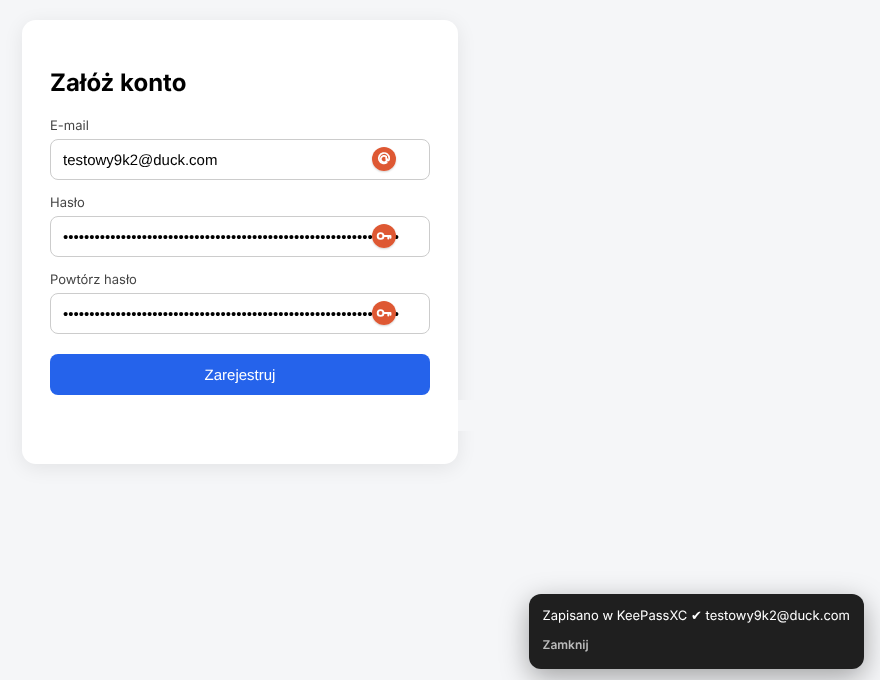

# DDG Alias + KeePassXC

Rozszerzenie do Chrome / Edge / Brave, które działa podobnie jak autouzupełnianie w przeglądarce DuckDuckGo:

- w każdym polu loginu / e-maila i hasła pojawia się ikonka,
- **jedno kliknięcie** wstawia nowy prywatny alias **@duck.com** (DuckDuckGo Email Protection) w pole e-mail **i** silne, 64-znakowe hasło w pola hasła,
- konto (login, hasło, adres strony) trafia do **KeePassXC** – w trybie prostym jednym kliknięciem „Nowy”, w trybie pełnym całkiem automatycznie,
- baza `.kdbx` jest ta sama co w telefonie (Keepass2Android / KeePassDX), więc nowe konta od razu są też w telefonie.



---

## Spis treści

1. [Wymagania](#1-wymagania)
2. [Instalacja krok po kroku](#2-instalacja-krok-po-kroku)
3. [Jak używać](#3-jak-używać)
4. [Ustawienia](#4-ustawienia)
5. [Rozwiązywanie problemów](#5-rozwiązywanie-problemów)
6. [Jak to działa](#6-jak-to-działa)
7. [Bezpieczeństwo](#7-bezpieczeństwo)
8. [Odinstalowanie](#8-odinstalowanie)

---

## 1. Wymagania

- Windows 10 / 11
- Chrome, Edge, Brave lub inna przeglądarka oparta na Chromium
- [KeePassXC](https://keepassxc.org) 2.7 lub nowszy
- Konto **DuckDuckGo Email Protection** (darmowe)

## 2. Instalacja krok po kroku

Całość zajmuje ok. 5 minut. Nie trzeba nic instalować poza rozszerzeniami.

### 2.1. Adres DuckDuckGo i KeePassXC

1. Nie masz adresu `@duck.com`? Wejdź na **duckduckgo.com/email** (w przeglądarce DuckDuckGo albo z rozszerzeniem *DuckDuckGo Privacy Essentials*), wybierz adres i podaj skrzynkę, na którą mają przychodzić maile.
2. Zainstaluj [KeePassXC](https://keepassxc.org) i otwórz swoją bazę `.kdbx`. Żeby była wspólna z telefonem, trzymaj ją np. na *Google Drive na komputer* i otwieraj ten sam plik w Keepass2Android / KeePassDX.
3. W KeePassXC: **Narzędzia → Ustawienia → Integracja z przeglądarką** → zaznacz **Włącz integrację** i swoją przeglądarkę → OK.
4. Zainstaluj oficjalne rozszerzenie **KeePassXC-Browser** ([Chrome](https://chromewebstore.google.com/detail/keepassxc-browser/oboonakemofpalcgghocfoadofidjkkk) · [Edge](https://microsoftedge.microsoft.com/addons/detail/keepassxcbrowser/pdffhmdngciaglkoonimfcmckehcpafo)), kliknij jego ikonę → **Połącz** i zatwierdź w KeePassXC. Ono wypełnia loginy i zapisuje nowe konta.

### 2.2. To rozszerzenie

1. **[⬇️ Pobierz ZIP](https://github.com/Kacperpe/ddg-alias-keepassxc/archive/refs/heads/main.zip)** i rozpakuj w stałe miejsce, np. `C:\Narzedzia` (w środku będzie folder `ddg-alias-keepassxc-main`). **Nie przenoś później tego folderu.**
2. Otwórz `chrome://extensions` (w Edge: `edge://extensions`) i włącz **Tryb dewelopera**.
3. Kliknij **Załaduj rozpakowane** i wskaż folder **`extension`**.
4. Same otworzą się ustawienia rozszerzenia (później: prawy klik na ikonę → **Opcje**).

### 2.3. Logowanie do DuckDuckGo (w ustawieniach rozszerzenia)

1. Wpisz swój adres, np. `kacper@duck.com` → **Wyślij kod**.
2. Na Twoją skrzynkę przyjdzie mail od DuckDuckGo z kodem z kilku słów (np. *apple banana cherry date*).
3. Wpisz te słowa → **Zaloguj** → zobaczysz ✅ *Zalogowano*. Możesz kliknąć *Wygeneruj testowy adres*.

Gotowe. W kroku 2 ustawień zobaczysz ✅ *Tryb prosty* – po rejestracji KeePassXC-Browser zapyta o zapis, kliknij **Nowy**.

### 2.4. (Opcjonalnie) Tryb pełny – zapis bez klikania „Nowy”

Chrome pozwala rozszerzeniu rozmawiać z programem na komputerze tylko przez wpis w rejestrze Windows. KeePassXC robi taki wpis wyłącznie dla swojego oficjalnego rozszerzenia, dlatego tutaj trzeba go dodać raz:

1. W pobranym folderze otwórz `windows` i kliknij dwa razy **`install.bat`** (bez uprawnień administratora, tylko dla Twojego konta).
2. Zamknij wszystkie okna przeglądarki i otwórz ją ponownie.
3. W ustawieniach rozszerzenia kliknij **Połącz z KeePassXC**, w okienku KeePassXC wpisz nazwę (np. `laptop`) → **Zapisz i zezwól**.

Od teraz nowe konta zapisują się same – zobaczysz w rogu **„Zapisano w KeePassXC ✔”**. W ustawieniach KeePassXC-Browser możesz wtedy wyłączyć pytanie o zapis nowych danych, żeby nie dublowało wpisów.

## 3. Jak używać

### Rejestracja na nowej stronie

1. Kliknij w pole e-mail. Na stronach rejestracji menu otwiera się samo; na innych kliknij ikonkę **@** w polu.
2. Wybierz **„Adres Duck + silne hasło”** (lub naciśnij Enter).
   → w polu e-mail pojawia się nowy alias, a w polach hasła i powtórzenia to samo 64-znakowe hasło.
3. Kliknij *Zarejestruj* / *Załóż konto*.
   → tryb prosty: KeePassXC-Browser pyta o zapis → **Nowy**.
   → tryb pełny: w rogu pojawia się **„Zapisano w KeePassXC ✔”**. Wpis trafia do grupy *KeePassXC-Browser Passwords* (lub Twojej z ustawień).

### Inne opcje

| Gdzie | Co robi |
|---|---|
| Ikonka **@** → *Tylko prywatny adres Duck* | Sam alias, hasło wpisujesz po swojemu |
| Ikonka **klucza** w polu hasła | *Użyj silnego hasła* (z podglądem) albo *Wygeneruj inne* |
| Powiadomienie → **Zapisz teraz** | Zapis do KeePassXC od razu, bez czekania na wysłanie formularza |
| Powiadomienie → **Kopiuj hasło** | Kopia hasła do schowka (zabezpieczenie) |
| Prawy przycisk w polu → *Wstaw alias DuckDuckGo / silne hasło* | To samo z menu kontekstowego |
| Ikona rozszerzenia na pasku | Alias lub hasło prosto do schowka |
| Klawiatura w menu | ↑ ↓ wybór, Enter zatwierdza, Esc zamyka |

### Logowanie na istniejące konta

To robi **KeePassXC-Browser** (osobne, oficjalne rozszerzenie KeePassXC) – zostaw je zainstalowane do wypełniania loginów. Żeby nie dostawać podwójnego pytania o zapis, w jego ustawieniach możesz wyłączyć zapisywanie nowych danych logowania – nowe konta zapisuje już DDG Alias.

## 4. Ustawienia

| Opcja | Domyślnie | Opis |
|---|---|---|
| Automatyczny zapis w KeePassXC (tryb pełny) | wł. | Zapis po wysłaniu formularza. Wyłączone = tylko przycisk „Zapisz teraz” |
| Grupa w bazie (tryb pełny) | *KeePassXC-Browser Passwords* | Np. `Internet/Konta`. Grupa musi istnieć w bazie |
| Menu od razu na rejestracji | wł. | Wyłączone = menu tylko po kliknięciu ikonki |
| Długość hasła | 64 | 8–128. Jeśli pole na stronie ma limit (`maxlength`), hasło dopasuje się samo |
| Znaki specjalne | wł. | Pełny zestaw 32 znaków specjalnych ASCII (np. `! " # $ % & * < > ? @ [ ] ^ ~`) |
| Historia aliasów | – | Lista: alias, strona, data + eksport CSV |

## 5. Rozwiązywanie problemów

| Problem | Rozwiązanie |
|---|---|
| Chcę zapis bez klikania „Nowy” | Tryb pełny – punkt 2.4 |
| ❌ *KeePassXC nie odpowiada* | Uruchom KeePassXC i włącz *Integrację z przeglądarką* w ustawieniach |
| ❌ *Baza KeePassXC jest zablokowana* | Odblokuj bazę (KeePassXC sam pokaże okno odblokowania) |
| ❌ *Ta baza nie jest połączona* | Opcje → *Połącz z KeePassXC* (np. po otwarciu innej bazy) |
| ❌ *KeePassXC nie rozpoznał klucza* | Połączenie usunięto w KeePassXC – połącz ponownie |
| ❌ *Sesja DuckDuckGo wygasła* / *Najpierw zaloguj się* | Ustawienia rozszerzenia → zaloguj się adresem Duck i kodem z maila (pkt 2.3) |
| Nie przychodzi kod od DuckDuckGo | Sprawdź spam na skrzynce przekierowania; po minucie kliknij *Wyślij kod* ponownie |
| Ikonka nie pojawia się na stronie | Strony systemowe (`chrome://`, sklep Chrome) są zablokowane dla rozszerzeń. Na innych – zgłoś adres w Issues |
| Strona odrzuca hasło | Zmniejsz długość albo wyłącz znaki specjalne w opcjach |
| Przeniosłem folder rozszerzenia | Usuń rozszerzenie, załaduj ponownie z nowego miejsca (ID zostaje to samo, mostek działa dalej) |
| Konflikt bazy na Drive (dwie kopie) | KeePassXC: *Baza danych → Scal z bazą* |

## 6. Jak to działa

```
 strona WWW                rozszerzenie (service worker)          Windows                    KeePassXC
┌──────────────┐  wiadomość  ┌──────────────────────────┐  native   ┌───────────────────┐  named pipe  ┌───────────┐
│ content.js   │───────────▶│ background.js + kpxc.js  │─messaging▶│ keepassxc-proxy   │─────────────▶│ baza .kdbx│
│ ikonki, menu │            │ szyfrowanie NaCl (box)   │           │ (z KeePassXC)     │              └───────────┘
└──────────────┘            └────────────┬─────────────┘           └───────────────────┘
                                         │ HTTPS
                                         ▼
                              quack.duckduckgo.com/api/email/addresses
```

- **Logowanie DDG**: `GET /api/auth/loginlink?user=` (wysyła kod na maila) → `GET /api/auth/login?user=&otp=` (jednorazowy token) → `GET /api/email/dashboard` (stały `access_token`). Ten sam przebieg co w aplikacjach DuckDuckGo.
- **Aliasy**: `POST https://quack.duckduckgo.com/api/email/addresses` z nagłówkiem `Authorization: Bearer <token>` – to samo API, którego używa DuckDuckGo i Bitwarden. Nieoficjalne, może się kiedyś zmienić.
- **Hasła**: generowane lokalnie przez `crypto.getRandomValues` (bez przesunięcia modulo), co najmniej jeden znak z każdej grupy, wymieszane algorytmem Fisher–Yates.
- **KeePassXC (tryb pełny)**: rozszerzenie mówi tym samym protokołem co oficjalny KeePassXC-Browser (`change-public-keys`, `associate`, `test-associate`, `get-databasehash`, `set-login`), szyfrowanym `crypto_box` (Curve25519 + XSalsa20-Poly1305, biblioteka [tweetnacl](https://github.com/dchest/tweetnacl-js)). Wiadomości idą przez `keepassxc-proxy.exe` dołączony do KeePassXC. `install.bat` rejestruje go pod własną nazwą `com.kacperpe.ddg_alias`, z dostępem tylko dla ID tego rozszerzenia.
- **Wykrywanie formularzy**: pola `type=email`, nazwy / placeholdery typu *email, login, user, konto*, pierwsze pole tekstowe w formularzu z hasłem. Rejestracja = dwa pola hasła, `autocomplete="new-password"` albo słowa *rejestracja / sign up / załóż konto* w formularzu lub adresie.
- **Zapis**: po wygenerowaniu danych rozszerzenie czeka na wysłanie formularza (submit, kliknięcie przycisku typu *Zarejestruj / Dalej*, Enter lub opuszczenie strony) i wysyła do KeePassXC aktualny login, hasło i adres strony.

### Struktura repozytorium

```
extension/            ← ten folder ładujesz w przeglądarce
  manifest.json       manifest MV3 (stałe ID przez pole "key")
  content.js          ikonki w polach, menu, wypełnianie, wykrywanie wysłania formularza
  background.js       API DuckDuckGo, obsługa KeePassXC, menu kontekstowe
  kpxc.js             klient protokołu KeePassXC
  nacl-fast.min.js    tweetnacl 1.0.3 (licencja: nacl-LICENSE.txt)
  options.html/.js    ustawienia, połączenie z KeePassXC, historia aliasów
  popup.html/.js      okienko pod ikoną rozszerzenia
windows/
  install.bat / .ps1  rejestracja mostka do KeePassXC
  uninstall.bat / .ps1
docs/podglad.png
```

## 7. Bezpieczeństwo

- Token DDG i klucz połączenia z KeePassXC są w `chrome.storage.local` przeglądarki (lokalnie, nie są synchronizowane).
- Wygenerowane hasła **nie są nigdzie zapisywane** poza polem formularza i Twoją bazą KeePassXC. Historia przechowuje tylko aliasy i domeny.
- Komunikacja z KeePassXC jest szyfrowana, a każda baza musi zostać ręcznie zatwierdzona w KeePassXC. Połączenie możesz w każdej chwili usunąć: KeePassXC → *Baza danych → Ustawienia bazy → Integracja z przeglądarką*.
- Rozszerzenie nie odczytuje haseł z bazy – tylko dodaje nowe wpisy.
- Mostek jest zarejestrowany tylko dla Twojego użytkownika Windows (`HKCU`).

## 8. Odinstalowanie

1. (jeśli używałeś trybu pełnego) `windows\uninstall.bat` – usuwa wpisy w rejestrze i manifest mostka.
2. `chrome://extensions` → *Usuń* przy DDG Alias + KeePassXC.
3. (opcjonalnie) KeePassXC → *Baza danych → Ustawienia bazy → Integracja z przeglądarką* → usuń klucz połączenia.

## Licencja

MIT – zobacz [LICENSE](LICENSE). Biblioteka tweetnacl jest w domenie publicznej (Unlicense).
